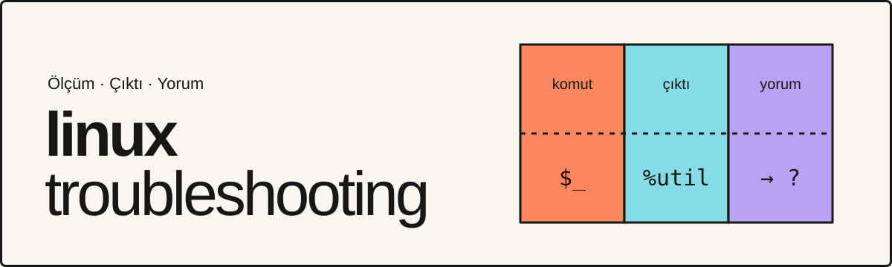

  

Linux sunucularda sorun giderme yazıları. Her yazı bağımsız bir case anlatır: önce ölçüm komutu, sonra örnek çıktı, sonra yorum.

> Örnek çıktılar temsilidir; gerçek bir incident ölçümü değildir.

**[Seri indeksini aç →](https://guneskursad.github.io/linux-troubleshooting/)**

## Yazılar

| # | Konu | Case | Durum |
|---|------|------|-------|
| 01 | [İlk ölçümler](https://guneskursad.github.io/linux-troubleshooting/01-ilk-olcumler.html) | API latency ve I/O beklemesi | Yayında |
| 02 | [CPU ve load](https://guneskursad.github.io/linux-troubleshooting/02-cpu-ve-load.html) | Dört bağımsız CPU durumu | Yayında |
| 03 | Memory ve bekleme | Swap kullanımı var, aktif swapping yok | Yakında |
| 04 | Disk ve I/O | Backup sırasında I/O latency | Yakında |
| 05 | Network ve packet drop | Bağımsız network alt örnekleri | Yakında |
| 06 | Host boşken uygulama beklemesi | CPU düşük, uygulama latency yüksek | Yakında |

## Her yazıda

1. **Komut:** kopyalanabilir ölçüm komutu.
2. **Örnek çıktı:** alanlar renkle işaretli.
3. **Yorum:** çıktıdan ne sonuç çıkar, ne çıkmaz.
